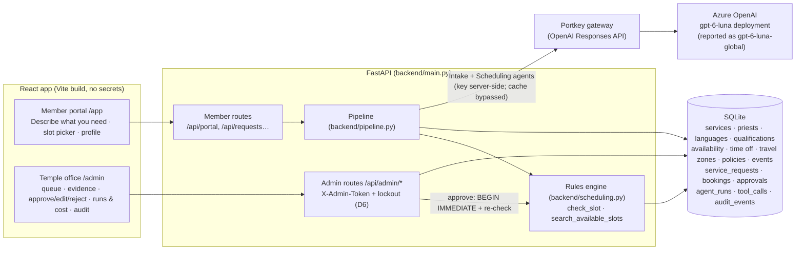

# SERVE architecture and agent–tool workflow (as implemented)

Source of truth: `backend/agents.py`, `backend/pipeline.py`, `backend/scheduling.py`,
`backend/defenses.py`, `backend/main.py`.

## System



## Request workflow

```mermaid
sequenceDiagram
  participant Mem as Member
  participant API as FastAPI
  participant D as Defenses (code)
  participant IA as Intake Agent (gpt-6-luna)
  participant SA as Scheduling Agent (gpt-6-luna)
  participant RE as Rules engine
  participant Adm as Administrator
  Mem->>API: POST /api/requests (free text, ≤1500 chars)
  API->>D: D1 sanitize · D2 injection screen (flag) · D4 dedupe/rate cap
  API-->>Mem: 202 processing
  API->>IA: today's date + <member_request> (catalog in cached prefix)
  IA->>RE: get_member_profile (this member only)
  IA-->>API: IntakeResult (service, dates, time preference, location, town, language, guests, needs)
  API->>API: code: validate service/dates, time window, missing-info check
  alt something missing
    API->>D: D3 filter clarifying question
    API-->>Mem: needs_info + question (member replies → re-run)
  else complete
    API->>SA: structured request (with earliest/latest start)
    SA->>RE: get_service_details · find_qualified_priests · get_travel_info · get_priest_day · search_available_slots · (verify_slot)
    Note over SA,RE: D5 per-tool budgets + UsageLimits (≤10 requests, ≤16 tool calls) + 120 s timeout
    SA-->>API: ScheduleRecommendation (≤3 options, notes)
    API->>RE: re-verify every option (check_slot); apply time-window policy; prices from DB
    API-->>Adm: pending_review with verified options, evidence, trace, cost, risk flags
  end
  Adm->>API: Approve option / Edit & approve (token)
  API->>RE: BEGIN IMMEDIATE · check_slot again · unique index backstop
  RE-->>API: ok → booking confirmed (else 409 with reasons)
  API-->>Mem: Approved + booking details (persisted)
```

## Agents and tools

| Agent | Output (Pydantic) | Tools (all read-only) | Limits |
|---|---|---|---|
| Intake | `IntakeResult` | `get_member_profile` (requesting member only); `list_services` in the *standard* profile only (the *optimized* profile embeds the catalog in the static prompt) | 4 model requests, 4 tool calls, 120 s |
| Scheduling | `ScheduleRecommendation` | `get_service_details`, `find_qualified_priests`, `get_travel_info`, `get_priest_day`, `search_available_slots`, `verify_slot`, `get_scheduling_policies` (standard only) | 10 model requests, 16 tool calls, per-tool budgets (D5), 120 s |

Deterministic (never the model): missing-information decision, time window from the
preference category, every option's validity and price, the time-preference policy,
duplicate/rate limits, and booking creation (admin approval route only).
